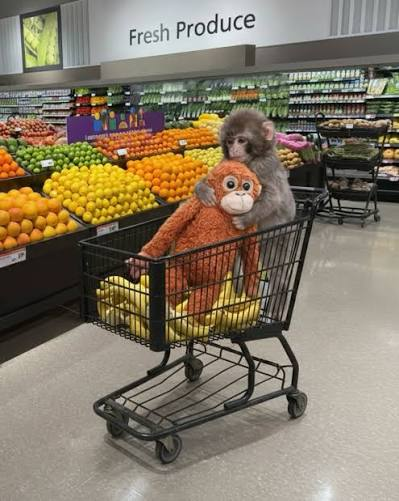

# CartCollision — моделирование неупругого столкновения тележек



# CartCollision

## Абсолютно неупругое столкновение двух тележек

### 1. Описание проекта

**CartCollision** — приложение для моделирования абсолютно неупругого столкновения двух тележек. Программа позволяет задать массы и начальные скорости тележек, наблюдать их движение до и после столкновения, а также проверить основные законы сохранения.

Проект разработан в рамках учебной работы по дисциплине «Виртуальный физический эксперимент».

### 2. Цель эксперимента

Изучить абсолютно неупругое столкновение двух тележек и проверить закон сохранения импульса. При таком столкновении тележки после контакта движутся вместе с общей скоростью.

### 3. Физическая модель

Рассматриваются две тележки массами `m₁` и `m₂`, движущиеся вдоль одной прямой с начальными скоростями `v₁` и `v₂`.

После абсолютно неупругого столкновения тележки движутся как одно тело с общей скоростью `v'`.

В модели учитываются:
- массы обеих тележек;
- начальные скорости и направления движения;
- положения тележек;
- момент столкновения;
- общая скорость после столкновения.

Внешними силами, влияющими на импульс системы во время столкновения, пренебрегаем.

### 4. Основные формулы

**Импульс системы до столкновения:**

`p_before = m₁v₁ + m₂v₂`

**Общая скорость после столкновения:**

`v' = (m₁v₁ + m₂v₂) / (m₁ + m₂)`

Скорости учитываются со знаками: положительная скорость соответствует выбранному положительному направлению, отрицательная — противоположному.

**Импульс системы после столкновения:**

`p_after = (m₁ + m₂)v'`

**Кинетическая энергия до столкновения:**

`E_before = (m₁v₁²) / 2 + (m₂v₂²) / 2`

**Кинетическая энергия после столкновения:**

`E_after = ((m₁ + m₂)(v')²) / 2`

При абсолютно неупругом столкновении импульс системы сохраняется, а кинетическая энергия не увеличивается. Часть кинетической энергии переходит в другие формы энергии.

### 5. Параметры модели

| Параметр | Описание | Единица измерения |
|---|---|---|
| `m₁` | Масса первой тележки | кг |
| `m₂` | Масса второй тележки | кг |
| `v₁` | Начальная скорость первой тележки | м/с |
| `v₂` | Начальная скорость второй тележки | м/с |
| `v'` | Общая скорость тележек после столкновения | м/с |
| `x₁` | Положение первой тележки | м |
| `x₂` | Положение второй тележки | м |
| `t` | Время моделирования | с |

### 6. Функциональность приложения

Приложение позволяет:
- задавать параметры тележек;
- запускать и наблюдать анимацию движения;
- отображать тележки разными цветами;
- наблюдать движение до столкновения, в момент контакта и после него;
- повторно запускать эксперимент;
- экспортировать данные траектории в CSV-файл для дальнейшего анализа.

### 7. Используемые технологии

- **Язык программирования:** C#
- **Графический интерфейс:** Windows Forms
- **Платформа:** .NET Framework 4.7.2
- **Среда разработки:** Microsoft Visual Studio
- **Контроль версий:** Git и GitHub
- **Экспорт результатов:** CSV

### 8. Структура проекта

Основные части проекта:

- `CartCollision` — приложение с графическим интерфейсом и анимацией.
- `CartCollision.Core` — библиотека с физической моделью столкновения.
- `CartCollision.Tests` — проект автоматизированных тестов модели.

### 9. Состав команды

| Роль | Ответственность |
|---|---|
| TeamLead | Организация работы команды, планирование задач, интеграция компонентов, контроль сроков и итоговая проверка проекта |
| Core | Реализация физической модели, проверка формул, единиц измерения и корректности вычислений |
| UI / View-Integration | Разработка пользовательского интерфейса, отображение тележек и интеграция интерфейса с моделью |

### 10. Запуск приложения

**Вариант 1. Запуск готовой сборки**

1. Откройте раздел [Releases](https://github.com/notyetdinohaha-png/CartCollision/releases).
2. Скачайте ZIP-архив последнего релиза.
3. Распакуйте архив в отдельную папку.
4. Запустите `CartCollision.exe`, если файл присутствует в сборке.

**Вариант 2. Запуск через Visual Studio**

1. Склонируйте репозиторий:

   ```bash
   git clone https://github.com/notyetdinohaha-png/CartCollision.git
   ```

2. Откройте файл `CartCollision.sln` в Visual Studio.
3. Дождитесь загрузки проектов и восстановления необходимых компонентов.
4. Соберите решение.
5. Запустите приложение клавишей `F5` или `Ctrl + F5`.

### 11. Проверка корректности модели

При проверке проекта рассматриваются следующие условия:

- корректность обработки входных параметров;
- движение тележек до столкновения;
- фиксация момента столкновения;
- совместное движение тележек после столкновения;
- правильность вычисления общей скорости;
- сохранение импульса системы;
- отсутствие увеличения кинетической энергии после абсолютно неупругого столкновения;
- корректность повторного запуска эксперимента;
- правильность экспорта траектории в CSV-файл.

Для проверки вычислений используются автоматизированные тесты. Результаты моделирования также проверяются при запуске приложения.

### 12. Репозиторий

Исходный код проекта, история изменений и задачи команды доступны в GitHub-репозитории:

[CartCollision — GitHub](https://github.com/notyetdinohaha-png/CartCollision)

Готовые сборки приложения доступны в разделе [Releases](https://github.com/notyetdinohaha-png/CartCollision/releases).
